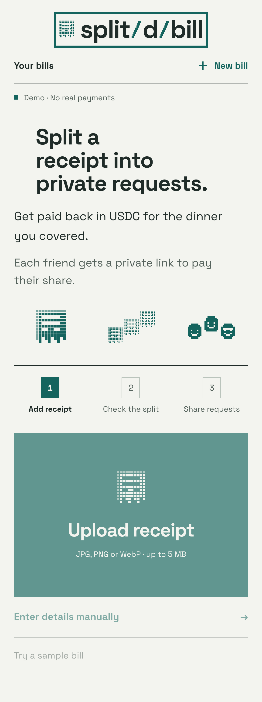
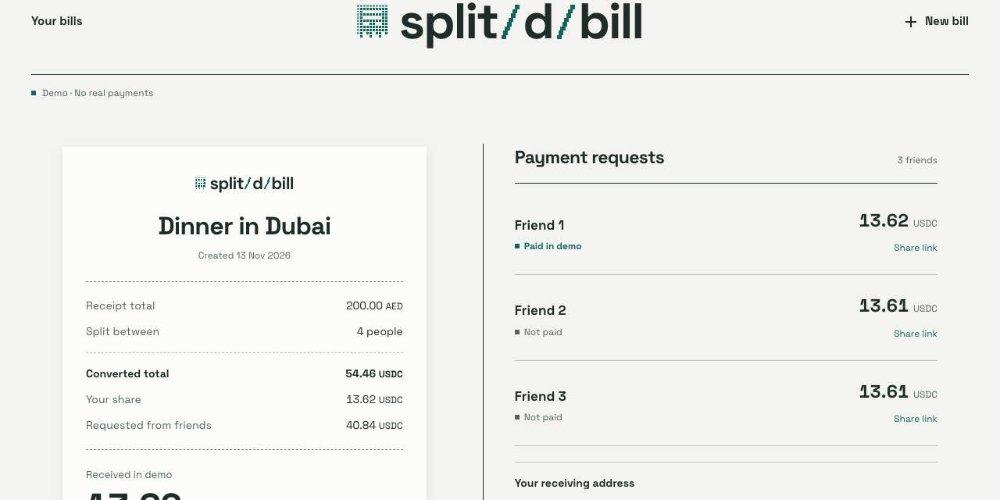
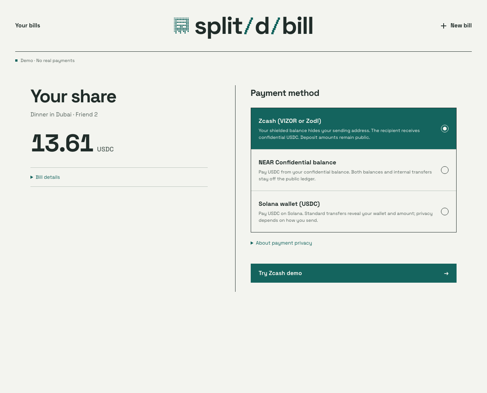

# split/d/bill

**Split a receipt into individual reimbursement requests.** split/d/bill helps friends meeting across borders confirm a shared bill, calculate equal USDC shares, give each payer a separate checkout link, and follow repayment progress.

The idea came from a friend at an international crypto event. After a shared meal, splitting the total and converting currencies by hand was cumbersome; some guests wanted to pay with shielded ZEC, and the organizer was concerned about sharing a main wallet address. split/d/bill turns the receipt into individual reimbursement requests and explains privacy by payment route.

The product contribution is the receipt-to-request flow. NEAR Intents is integrated for supported cross-chain payment routing toward an organizer's Confidential Intents USDC balance. Privacy varies by route: ordinary Solana USDC transfers expose sender and amount, Zcash deposit details can be public, and providers process routing data. The app does not claim universal anonymity.



[Watch the 73-second synthetic demo](docs/hackathon/assets/demo.mp4) — bill review, separate share checkout, simulated success, and organizer progress. No funds move in the recording.

## Try the local demo

Requirements: Node.js 24 and npm. No credentials or wallet are needed for the local simulation.

From the repository root:

```sh
cd app-web
node --version
npm ci
npm run build
node --import ./scripts/sites-env.mjs ./node_modules/wrangler/bin/wrangler.js d1 execute DB --local --config dist/server/wrangler.json --persist-to .wrangler/state --file drizzle/0000_organic_jimmy_woo.sql
node --import ./scripts/sites-env.mjs ./node_modules/wrangler/bin/wrangler.js d1 execute DB --local --config dist/server/wrangler.json --persist-to .wrangler/state --file drizzle/0001_complete_bruce_banner.sql
node --import ./scripts/sites-env.mjs ./node_modules/wrangler/bin/wrangler.js d1 execute DB --local --config dist/server/wrangler.json --persist-to .wrangler/state --file drizzle/0002_durable_live_payments.sql
node --import ./scripts/sites-env.mjs ./node_modules/wrangler/bin/wrangler.js d1 execute DB --local --config dist/server/wrangler.json --persist-to .wrangler/state --file drizzle/0003_unique_live_deposit.sql
npm run dev -- --port 5173
```

Expected result: `node --version` reports v24.x and the local app is available at [http://127.0.0.1:5173](http://127.0.0.1:5173). Keep the server running while following these steps:

1. Choose **Try a sample bill** → see a synthetic 200 AED receipt and the **Demo · No real payments** label.
2. Enter `nearcom:demo.near` as the synthetic organizer receiving address (never send funds to it), confirm the sample bill details, and choose **Review split** → see the dated reference conversion and equal USDC shares. The organizer's share is excluded from reimbursements.
3. Create demo requests → see separate private checkout links for the other diners.
4. Open a share checkout → choose a payment method → choose **Try … demo** → see demo payment controls; no fundable address or wallet link is created.
5. Choose **Simulate successful payment** → return to the organizer page and see that share marked paid in demo. Reload the page → see the persisted simulated status.



The sample receipt and simulated payment outcomes are synthetic. The conversion is a dated fiat reference rate with a labelled demo fallback; it is not a payment quote. Simulation does not create an executable quote, wallet request, signature, transfer, or settlement. Upload is available, but OCR is not connected; uploaded receipts require manual confirmation.



Apply the four local D1 migrations only once to a fresh local database. The `.wrangler/` folder contains disposable local data and is ignored by Git. `npm run start -- --port 5173` previews a production build against this same local database. More options and setup details are in [app-web/README.md](app-web/README.md).

## What is implemented

- Receipt upload or manual entry, manual total confirmation, equal cent-accurate splitting, dated fiat reference conversions, and persisted bill/share records.
- Private per-diner checkout capabilities and organizer recovery links, separate status views, private receipt access, and simulated settlement tracking.
- Payment adapters for Zcash (VIZOR or Zodl), existing NEAR Confidential Intents balances, and Solana USDC. The Solana route discloses public sender/amount visibility; wallet branding does not change that.
- Verified dry quotes for the supported routes, immutable organizer receiving-account binding, quote allocation, settlement reconciliation, and NEP-413 signing for compatible external NEAR wallets.
- An owner-only pilot that permits real Solana/Zcash payment requests. Confidential-balance sending remains disabled. Real wallet handoff, refunds, funded transfers and actual confidential receiving credit have not passed acceptance; all acceptance flags remain false.

The hosted [Vercel owner pilot](https://split-d-bill.vercel.app) requires the owner's private access. It is not an open public demo. No password is included in this repository. The deployed application and every payment gate must be treated according to their explicit on-screen status; sample bills remain simulations.

## NEAR Hackathon tracks

- **Real-World Money (`realworld`)** — split a real-world shared expense into stablecoin reimbursement requests, with NEAR Intents as the intended routing layer. This is the clearest fit.
- **Privacy & Private AI (`privacy`)** — supports shielded-source ZEC and Confidential Intents receiving/payment paths, with specific privacy explanations and limits. No universal anonymity, end-to-end unlinkability, or private-AI receipt processing is claimed.
- **Social Money (`social`)** — coordinates a small group expense through separate payer links and shared reimbursement status. The app does not integrate Sputnik DAO or Trezu; track hints are not implementation requirements.

## Build baseline, reused software, and AI assistance

The tracked project history starts with workspace commit [`9a1d14f`](https://github.com/youngjei/near-hackathon-2026/commit/9a1d14f) on November 9, 2026. That commit contains hackathon preparation and project research; the `app-web/` application was added during the hackathon window beginning November 10. There is no pre-November 1 application baseline in this repository. To review the project work from the initial workspace commit to the checked-out revision, run `git diff --stat 9a1d14f..HEAD`.

The app uses open-source runtime and UI libraries, including React, Next.js, Vinext, Supabase, Drizzle ORM, and NEAR Connect; exact versions are pinned in `app-web/package-lock.json`. No external app template or pre-existing splitdbill codebase was used. Space Grotesk is distributed under the SIL Open Font License in `app-web/public/fonts/OFL-Space-Grotesk.txt`. Research references and third-party prompt files under `docs/hackathon/reference/` retain their original authorship and are not project code.

Project-authored code and documentation are released under the [MIT License](LICENSE). The bundled font and third-party reference material retain their own terms.

Codex assisted with research, implementation, and documentation; the project owner directed product decisions and reviewed changes. The optional NEAR AI receipt adapter is not connected to the demo, and no model call is made when using the sample flow.

## Further reading

- [Current project status](docs/project/STATUS.md) · [Decisions](docs/project/DECISIONS.md) · [Build log](docs/project/BUILD_LOG.md)
- [Beta scope](docs/project/BETA_SCOPE.md) · [Privacy findings and limits](docs/technical/PRIVACY.md) · [Payment adapter status](docs/technical/PAYMENT_ADAPTER.md)
- [Application setup, validation and wallet limits](app-web/README.md)
- [Hackathon brief and reproducible submission checklist](docs/hackathon/BRIEF.md) · [Demo recording plan](docs/hackathon/DEMO_PLAN.md)
