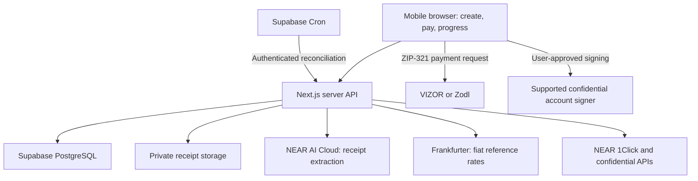

# Recommended beta stack

Checked November 10, 2026. This is an implementation recommendation, not installed software or provisioned infrastructure. Product scope is [BETA_SCOPE.md](../project/BETA_SCOPE.md).

## Languages and application

Use TypeScript for the browser, backend, payment adapters and tests; SQL for PostgreSQL schema and atomic database operations; CSS through Tailwind for styling. Existing Python scripts remain research utilities. The beta needs no custom Rust/Solidity contract and no native mobile application.

Build one mobile-friendly Next.js App Router application with React and server route handlers running on Node.js. Use Tailwind and shadcn/ui for accessible components; this does not settle the visual design. Pin compatible stable versions and a lockfile when implementation starts.

## Dependencies

| Layer | Recommendation | Purpose |
| --- | --- | --- |
| UI and backend | Next.js, React, TypeScript | Receipt creation, individual checkout, organizer progress and server API in one repository |
| Database and receipt files | Supabase PostgreSQL, private Storage, `@supabase/supabase-js` | Bills, shares, attempts, sessions and access-controlled receipt images |
| Payment integration | `@defuse-protocol/one-click-sdk-typescript` | Supported assets, exact-output quotes, execution status and quote-signature checks |
| Confidential signing | `@defuse-protocol/intents-sdk` plus the actual wallet's supported signer | Intent construction/signing helpers; ownership proof and user-approved spending are distinct |
| Zcash handoff | ZIP-321 request URI plus `qrcode` | Prefilled ZEC amount/address for VIZOR and Zodl; verify actual app releases on devices |
| Receipt extraction | NEAR AI Cloud API, behind a small provider adapter | Image to structured total/currency/merchant; organizer confirms before bill creation |
| Fiat conversion | Frankfurter v2 REST API | Dated reference rates such as AED/USD; cache rates and store their date/source |
| Validation and money | `zod`, `decimal.js`, integer base units | Validate external data; deterministic allocation and rounding |
| Background reconciliation | Supabase Cron calling a protected Next.js route | Check pending attempts after browsers close; bounded batches and idempotent updates |
| Hosting | Vercel, subject to appropriate plan | Host the Next.js app and server API |
| Tests | Vitest, Playwright | Money/state tests and browser journeys; separate real-device wallet checks |

The SDKs reduce integration work; they do not confer Confidential Intents access. Avoid mutable global SDK credentials across concurrent users: isolate authenticated requests, or use a small typed HTTP adapter for endpoints requiring per-user authorization. Keep partner keys and private user tokens server-side. No wallet seeds or spending keys belong on the server.

The exact confidential wallet connector remains unresolved. An existing confidential balance does not itself provide a standard browser-connect API, and generic NEAR wallet support does not establish access to a near.com account. Confirm the chosen wallet's account identifier, signing methods and permissions before implementing that checkout.

## Application architecture

This diagram shows application calls and wallet handoffs, not custody. Funds follow the payment paths below; the app server coordinates requests and status.

1. Organizer uploads a receipt into private storage. Server requests extraction; organizer corrects/confirms the result and diner count.
2. Fetch dated fiat reference rate. Display the proposed USDC reimbursement total and have the organizer confirm it. Treat the USD-to-USDC accounting convention explicitly; a fiat reference rate is not a guaranteed USDC market price. Store the fixed requested USDC amounts.
3. Create one bill and N−1 shares when N includes the organizer. Use deterministic rounding so allocations equal the approved total, including the organizer's portion.
4. Issue individual checkout capabilities. A shared invitation must not return every diner's payment metadata. A generic invitation can allocate a share atomically and then issue an individual session.
5. At checkout, create a fresh payment attempt and executable quote. The invitation QR identifies the bill/share; the payment QR identifies the specific current Zcash request.
6. Zcash path: shielded wallet sends quoted ZEC to the returned Zcash deposit address; the route is intended to deliver confidential USDC to the organizer. The bridge deposit is not itself a shielded destination. Confirm payer-controlled refund address compatibility before execution.
7. Existing confidential USDC path: obtain the quote, generate the spending intent, request the user's wallet signature, submit it and reconcile settlement. Validate third-party receiving end to end before claiming this works.
8. Server verifies authoritative settlement and updates the share once. Browser displays sanitized status; it never marks a share paid simply because a wallet opened or a transaction hash was supplied.

Core records: `Bill → Share → PaymentAttempt`. Preserve expired/replaced attempts for late deposit reconciliation. Use transactions, unique constraints and idempotent updates to prevent double claiming or double counting. Store money in integer base units, use decimal arithmetic for FX, and serialize large integers as strings through JSON.

Use opaque, HTTP-only application sessions and hashed per-share capabilities. Organizer access requires verified account control. App sessions and NEAR user tokens are different credentials. Private storage and database policies must restrict access; a public receipt URL or unrestricted service-role endpoint would defeat this design. Return only the payment information needed by the current diner.

## Infrastructure and hackathon benefits

- **NEAR AI credits:** live organizer Q-000 offers $10 through the NEAR Builders dashboard. This is a separate API key with a $10 balance, not a credit applied to the cloud.near.ai dashboard. Useful for receipt experiments. No credit was claimed.
- **NEAR partner/community support:** prioritize Confidential Intents enablement, user/partner auth composition, wallet signing, minimum payment amounts, fees, deadlines and Zcash refunds. Hackathon participation is not evidence that private API access has been granted.
- **Public RPC:** useful where account/nonce reads require it; it does not replace private APIs or partner credentials. No dedicated node is needed for this beta.
- **Free NEAR testnet funds:** little immediate value because there is no custom contract and Intents has no testnet. The guide says mainnet costs are not reimbursed by default.
- **Supabase:** ordinary free plan currently includes 500 MB database and 1 GB file storage, subject to quotas and inactivity pausing. This is not a special hackathon grant.
- **Vercel:** Hobby is for personal noncommercial use. Use an appropriate plan for the actual deployment; nothing has been provisioned. Do not depend on Hobby cron for timely payment checks: its daily frequency is unsuitable. Supabase Cron can invoke the protected reconciliation endpoint on a suitable shorter interval, with rate limits and quotas respected.

No present need for Aurora, a custom solver, Chain Signatures, an agent marketplace, a Zcash node, multisig treasury infrastructure or self-hosted TEE inference. These do not improve the scoped receipt-to-reimbursement flow.

## Verified versus pending

- Official API/library docs reviewed. Frankfurter AED/USD endpoint returned a dated rate in a read-only probe.
- Both NEAR AI model-list endpoints attempted returned service errors. No image-capable model was selected, no receipt was submitted, and no OCR accuracy or credit-key compatibility was tested. Choose the model using actual input-modality metadata and a receipt test once access works. Manual total/currency entry remains a useful product fallback.
- NEAR AI exposes different privacy tiers, including upstream models outside a TEE. Do not label all receipt processing confidential. Choose the intended tier and implement the documented verification if making that claim. The optional `@nearai/inference-sdk` can help with verification; check its runtime requirements when adopting it.
- Existing research establishes some authentication and unfunded quote behavior; it does not prove the proposed confidential payment paths. Partner enablement, wallet handoff, refunds and funded settlement remain pending.
- No packages installed, app code written, cloud services provisioned, funds moved or new credentials created in this recommendation.

## Primary sources

- [Next.js App Router](https://nextjs.org/docs/app), [shadcn/ui](https://ui.shadcn.com/docs)
- [1Click SDK](https://docs.near-intents.org/integration/distribution-channels/1click-api/sdk), [Intents SDK](https://docs.near-intents.org/integration/devkit/intents-sdk)
- [ZIP-321](https://zips.z.cash/zip-0321), [qrcode](https://github.com/soldair/node-qrcode)
- [NEAR AI model tiers](https://docs.near.ai/cloud/models), [JavaScript inference SDK](https://docs.near.ai/cloud/inference-sdk/javascript)
- [Frankfurter](https://frankfurter.dev), [Zod](https://zod.dev), [decimal.js](https://mikemcl.github.io/decimal.js/)
- [Supabase pricing](https://supabase.com/pricing), [Cron](https://supabase.com/docs/guides/cron)
- [Vercel Hobby](https://vercel.com/docs/plans/hobby), [cron limits](https://vercel.com/docs/schedules/cron-jobs/usage-and-pricing)
- [Vitest](https://vitest.dev/guide/), [Playwright](https://playwright.dev/docs/intro)
- [Live hackathon guide](https://nearhackathon.com/HACKATHON.md), [credit dashboard](https://nearbuilders.org/dashboard), [builder resources](https://nearbuilders.org/build)
